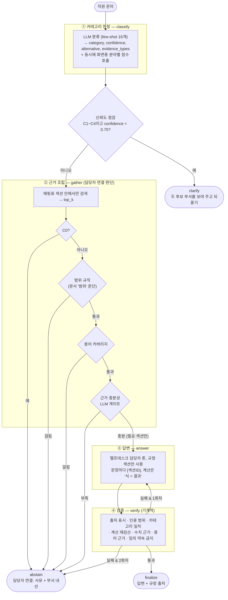
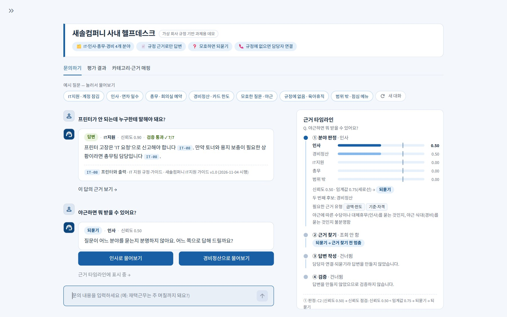
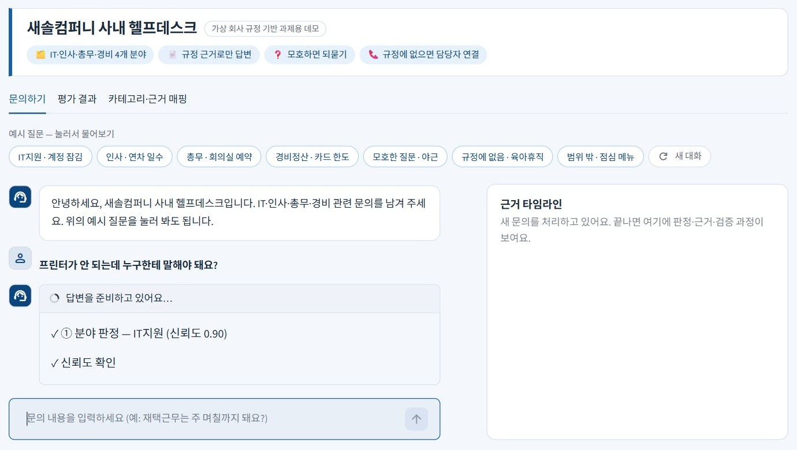
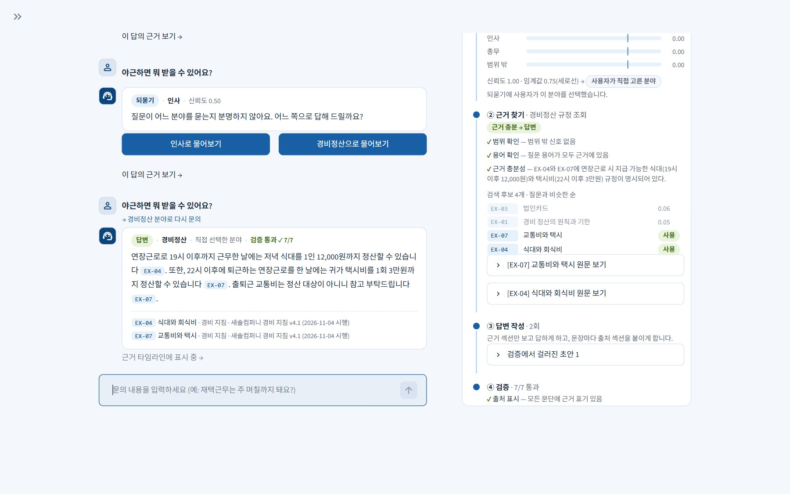

# REPORT — 사내 문의 응대 라우팅 에이전트 (새솔컴퍼니 헬프데스크)

직원 문의를 IT지원·인사·총무·경비정산·범위 밖으로 분류하고, 그 분야의 사내 규정에서만 답한다. 분야가 모호하면 되묻고, 규정에 없으면 지어내지 않고 담당 부서로 연결한다.

```
입력 → ① 카테고리 판정(신뢰도) → 신뢰도 점검 → ② 카테고리별 근거 조립 → ③ 근거만으로 답변 → ④ 검증
                                    ↓                    ↓                                    ↓
                            낮으면 되묻기       근거 부족이면 담당자 연결         2회 실패하면 담당자 연결
```

**최종 결과** (Google `gemma-4-26b-a4b-it` 무료 모델, 평가셋 50문항, 키워드 채점기)

| 과제 지표 | | PRD 지표 | |
|---|---|---|---|
| 도구 호출 적절성 | **48/50 (96%)** | 분류 정확도 | 49/50 (98%) |
| 답변 적절성 | **45/50 (90%)** | 근거 적합성 | 32/32 (100%) |
| 미공개 10문항 도구 호출 | 10/10 (100%) | 답변 정확성 | 29/32 (91%) |
| | | 근거 없는 정보 생성 | **0/32 (0%)** |
| | | 보류(담당자 연결) 정확도 | 48/50 (96%) |

---

## 1. 주제와 근거 문서

**주제**: 사내 헬프데스크(IT·인사·총무·경비) 문의 응대. 수업에서 다룬 고객응대 라우팅을 사내 고객(직원)에게 적용했다.

고른 이유
- 사내 문의는 **담당 부서가 분명히 나뉘어** 있어 라우팅이 실제 업무 흐름과 같다. 잘못 분류하면 엉뚱한 부서 규정으로 답하게 된다.
- **그럴듯한 오답이 위험한 분야다.** "헬프데스크에 전화하면 비밀번호를 알려 준다", "간이영수증도 다 정산된다", "사후 승인 받으면 야근 수당 나온다"처럼 흔한 오해를 그대로 답하면 보안사고나 정산 반려로 이어진다.
- 규정에 없는 것(연봉, 육아휴직 급여, 개인 짐 보관)을 **약속하면 안 되는** 경우가 많아 '담당자 연결'이 꼭 필요하다.

**근거 문서** (`docs/`, 4개 문서 · 33개 섹션). 과제용 **가상 회사 '새솔컴퍼니'의 가상 규정**이다.
- 실제 회사 내부 문서를 공개 저장소에 올릴 수 없어서 직접 작성했다.
- 법정 기준(근로시간 주 40시간, 연장근로 주 12시간과 가산 50%, 연차 15일·월 1일·2년마다 1일 가산·최대 25일)만 실제 근로기준법 제50·53·56·60·61조를 요약했다.
- 한도·절차·담당 부서는 가상이며 문서 머리에 명시했다.
- 섹션마다 ID(`[EX-05]`), 출처 조항(`새솔컴퍼니 출장비 규정 제6조`), 문서 버전을 붙였다.

| 문서 | 섹션 | 내용 |
|---|---|---|
| `01_it_support.md` | IT-01~08 | 헬프데스크, 계정·비밀번호, VPN, 장비 지급·교체, 소프트웨어 설치, 보안사고, 메일, 프린터 |
| `02_hr.md` | HR-01~08 | 근무시간·시차출퇴근, 연장근로, 연차 발생·사용·촉진, 경조휴가, 병가, 재택근무, 제증명 |
| `03_general_affairs.md` | GA-01~08 | 사원증, 회의실, 비품, 우편·택배, 주차, 명함, 시설 고장, 법인차량 |
| `04_expense.md` | EX-01~09 | 정산 기한, 증빙, 법인카드 한도, 식대·회식비, 국내·해외 출장비, 택시, 접대비, 개인카드·반려 |

---

## 2. 카테고리 설계

### 나눈 기준
**"이 문의를 처리하는 담당 부서가 어디인가."** 사내 헬프데스크는 결국 문의를 맞는 부서로 보내는 일이라, 조직 구조를 그대로 카테고리로 삼았다. 같은 '야근'이라도 수당·대체휴무는 인사(C2), 식대·택시비는 경비(C4)가 답한다.

| 키 | 카테고리 | 도구 | 담당자 연결 시 문의처 |
|---|---|---|---|
| C1 | IT지원 | `lookup_it` | IT헬프데스크(내선 1100) |
| C2 | 인사 | `lookup_hr` | 인사팀(내선 1200) |
| C3 | 총무 | `lookup_ga` | 총무팀(내선 1300) |
| C4 | 경비정산 | `lookup_expense` | 재무팀 경비 담당(내선 1400) |
| C0 | 범위 밖 | 없음 → `abstain` | 소속 팀장 |

### 카테고리 ↔ 근거 매핑표
| 카테고리 | 연결 섹션 | 교차 연결과 이유 | 다루지 않는 범위(→ 담당자 연결) |
|---|---|---|---|
| C1 IT지원 | IT-01~08 + **HR-07** | VPN 발급 조건이 재택근무 승인에 걸려 있음 | 개인 기기 수리, 보안 우회, 다른 직원 계정 |
| C2 인사 | HR-01~08 | — | 개인별 급여·연봉, 인사평가 결과, 징계, 노무 자문, 육아휴직·배우자 출산휴가 세부 |
| C3 총무 | GA-01~08 | — | 개인 물품 보관, 사옥 외부 시설, 임대차·관리비 |
| C4 경비정산 | EX-01~09 + **GA-08** | 법인차량 주유비 정산 규정이 차량 이용 규정에 있음 | 연말정산·세금 신고, 급여 계산, 회계 처리 |
| C0 | (없음) | — | 전부 |

`context.check_mapping()`이 매핑된 섹션 존재 여부, 어디에도 연결되지 않은 섹션, 출처 없는 섹션을 검사한다(문제 0건).

### 사내 응대에 맞춘 설계
| 부분 | 설계 |
|---|---|
| 모르면 | 지어내지 않고 **담당자 연결**: 사유와 담당 부서 내선을 안내한다 |
| ④ 검증 7번 | **임의 약속 금지**: "승인해 드리겠습니다", "이번만 예외로" 같은 표현을 막는다. 승인은 팀장·담당 부서의 권한이기 때문이다 |
| 용어 사전 | 사내 제도 용어 73개. 규정에 있는 용어와, 규정에 없어 답변에 나오면 지어낸 것으로 보는 용어(안식휴가, 성과급, 복지포인트 등)로 나눴다 |
| 답변 규칙 | 헬프데스크 담당자 톤: 존댓말, 신청 경로(사내 포털 메뉴·시스템) 안내, **승인·예외를 약속하지 않음** |

---

## 3. 평가셋 설계

`data/goldenset.json` — **50문항**(C1~C4 각 10, C0 7, 모호 3). 정답 행동은 **답변 32 · 담당자 연결 15 · 되묻기 3**이다.

| 카테고리 | 답할 수 있는 문항 예 | 담당자 연결이 정답인 문항 |
|---|---|---|
| C1 IT지원 | 계정 잠김, 비밀번호 규칙, 개인 노트북 VPN, 3년 된 노트북 교체, 목록 외 SW 설치, 피싱, 악성코드 시 전원, 30MB 첨부 | USB 허용, 개인 휴대폰 수리 |
| C2 인사 | 2년차 연차 일수, 첫해 연차, 연차 신청 기한, 반반차, 미사용 연차 보상, 결혼 휴가·경조금, 승인 없는 야근, 수습 중 재택 | 내 연봉 인상액, 육아휴직 급여 |
| C3 총무 | 사원증 분실, 회의실 예약 범위, 회의실 지각, 의자 개인 구매, 개인 택배, 택배 마감, 방문객 주차, 법인차량 첫 이용 | 사옥 관리비, 개인 짐 보관 |
| C4 경비정산 | 정산 기한, 간이영수증 5만원, 대리 카드 한도, 야근 식대, **출장 2박 3일 일비 계산**, 서울 호텔 13만원, 해외 비즈니스석, 야근 택시 | 연말정산 의료비, 법인카드 포인트 |
| C0 | — | 점심, 주식, 다른 직원 연봉, 다른 회사 재택, 엑셀 자동화, 날씨, 휴대폰 추천 |
| 모호 | — | **되묻기**: "야근하면 뭐 받아요?"(인사/경비), "출장 갈 때 차는?"(총무/경비), "사원증이 안 돼요"(총무/IT) |

- **반드시 담을 사실** 62개는 근거 섹션 문장에서만 뽑았다.
- **말하면 안 되는 것** 47개는 문서를 안 읽으면 나오기 쉬운 오답이다. 예를 들면 다음과 같다.
  - "전화하면 비밀번호를 알려 준다"
  - "2년차라 가산되어 16일"
  - "2박이니 일비 4만원"(박 수로 계산)
  - "13만원 전액 정산"
  - "본부장 승인 받으면 비즈니스석"
- **예시와 평가 분리**: 프롬프트 예시는 `data/fewshot.json`에만 둔다. 작성 직후 겹침 검사에서 평가 문항 O01("오늘 점심 뭐 먹을까요?")이 예시 "오늘 날씨 어때요?"와 유사도 0.76으로 걸려, 예시를 다른 질문으로 바꿨다.
- **미공개 10문항**(`data/holdout.json`): 규칙·키워드를 만든 뒤 작성했고, 이번에는 미공개 문항을 보고 고친 코드가 없다.

---

## 4. 측정 결과

### 채점기 검증
| 채점기 | 결과 |
|---|---|
| 키워드 채점기 | **100/100** (모범 답안 50개는 1점, 오답 50개는 0점) |
| LLM 채점기 | 미측정 — 무료 호출을 아끼려고 검증된 키워드 채점기로 측정했다 |

### 모델 선택 과정
처음 쓰려던 OpenAI 실습 키의 **크레딧이 소진**됐다("You have no credits remaining"). 무료로 진행하기 위해 Gemini API 키로 쓸 수 있는 모델을 확인했다.
- Gemini 무료 등급은 모델당 하루 20회라 50문항(약 120회 호출)이 불가능하다.
- 그래서 Google의 공개 모델 **Gemma 4**(`gemma-4-26b-a4b-it`)를 골랐다. `gemma-4-31b-it`은 한 번 호출에 76초가 걸리고 500 오류가 나서 제외했다.

Gemma를 쓰면서 새로 생긴 문제와 대응은 다음과 같다(`llm.py`).

| 문제 | 증상 | 대응 |
|---|---|---|
| 일부 입력에서 서버 오류 | T04 답변 생성이 매번 500/504 | 재시도 시 지시를 system 대신 본문에 합쳐 보냄 |
| 끝없는 생성 | Q03 답변이 시간 초과 | `max_output_tokens=1024` 상한 |
| JSON 모드 빈 응답 | G09 판정이 빈 문자열 | Gemma는 JSON 모드 대신 텍스트로 받아 JSON 부분을 꺼냄. 깨진 응답은 캐시에서 지우고 다시 물음 |
| 일시 오류로 측정 중단 | 한 문항 오류로 전체 중단 | 오류 문항을 건너뛰고 계속, 빠진 문항이 있으면 결과를 기록하지 않고 재실행 안내 |

### 개선 시도별 기록표
원본은 `results/history.md`, 문항별 결과는 `results/run_*.json`, 오답 분석은 `results/run_*_errors.md`.

| # | 바꾼 것 | 도구 호출 | 답변 적절성 | 분류 | 근거 적합 | 답변 정확 | 근거 없는 생성 | 보류 정확 |
|---|---|---|---|---|---|---|---|---|
| 0 | offline 기준선 | 42/50 (84%) | 25/50 (50%) | 42/50 (84%) | 29/32 (91%) | 12/32 (38%) | 0/33 (0%) | 42/50 (84%) |
| 1 | **Gemma 기준선** | 46/50 (92%) | 43/50 (86%) | 47/50 (94%) | 30/32 (94%) | 27/32 (84%) | 0/30 (0%) | 46/50 (92%) |
| 2 | + 분류 지침: C2에 "야근 수당 인정 여부", C3에 "비품 개인 구매 가능 여부" | **48/50 (96%)** | **45/50 (90%)** | 49/50 (98%) | 32/32 (100%) | 29/32 (91%) | 0/32 (0%) | 48/50 (96%) |
| H | 2번 설정으로 **미공개 10문항** | 10/10 (100%) | 10/10 (100%) | 10/10 | 8/8 | 8/8 | 0/8 | 10/10 |
| 3 | 판정 프롬프트가 분야별 점수(`scores`)도 함께 내게 함 (화면 막대용) | 47/50 (94%) | 44/50 (88%) | 49/50 (98%) | 31/32 (97%) | 28/32 (88%) | 0/33 (0%) | 47/50 (94%) |
| 4 | 3번에서 점수를 먼저 매기고 가장 높은 분야를 판정으로 | 46/50 (92%) | 43/50 (86%) | 49/50 (98%) | 30/32 (94%) | 27/32 (84%) | 0/31 (0%) | 46/50 (92%) |
| 5 | **판정 프롬프트는 2번 그대로, 점수는 동시에 보내는 별도 호출** | **48/50 (96%)** | **45/50 (90%)** | 49/50 (98%) | 32/32 (100%) | 29/32 (91%) | 0/33 (0%) | 48/50 (96%) |

**2번의 근거**: 기준선에서 H07("야근을 팀장 승인 없이 했는데 수당 받을 수 있나요?")과 G04("새 의자 그냥 사서 영수증 내면 되죠?")가 '수당'·'영수증'이라는 단어 때문에 C4(경비)로 분류됐다. 경비 규정에는 답이 없어서 ② 게이트가 **올바르게 담당자 연결**로 넘겼다(지어내지 않은 안전한 실패). 원인이 '단어 대 의도' 혼동이라, 해당 카테고리 설명에 그 문의 유형을 명시했다.

**3~5번의 근거**: 데모에 분야별 점수 막대를 넣으려고 판정 호출이 점수도 함께 내게 했다(3번). 그러자 Q01 "야근하면 뭐 받을 수 있어요?"의 신뢰도가 0.50에서 0.85로 올라 되묻지 않고 인사로 답했다. 판정을 먼저 정하고 점수를 뒤늦게 덧붙이는 순서라 점수가 판정에 쓰이지 않은 것으로 보고, 점수를 먼저 매기게 바꿨다(4번). Q01은 다시 되물었지만 G03·G04가 0.70으로 내려가 불필요하게 되물었다. 두 시도 모두 2번보다 나빠서, 판정 프롬프트는 2번으로 되돌리고 화면용 점수만 별도 호출로 받았다(5번). 판정 결과는 2번과 문항별로 같다. 화면에 보이는 정보를 늘리는 변경도 판정 프롬프트를 건드리면 측정해야 한다는 것을 확인했다.

### 신뢰도 임계값 분석 (2번 결과의 판정 신뢰도로 계산, API 호출 없음)
| 임계값 | 모호 문항 되묻기 | 불필요한 되묻기 |
|---|---|---|
| 0.6 | 1/3 | 0 |
| **0.75 (기본값)** | **2/3** | **1** (G09) |
| 0.91 | 2/3 | 4 |
| 0.96 | 3/3 | 30 |

Gemma는 모호한 Q01·Q02에 0.5·0.7을 줘 모호함을 어느 정도 드러냈다. 그러나 Q03("사원증이 안 돼요")에는 0.95를 줬고, 나머지 37문항 중 26개가 0.95라 **임계값 하나로 완벽히 가르기는 여전히 어렵다**. 기본값 0.75를 유지했다.

### 틀린 건 원인 분류 (최종 2번, 직접 읽은 결과)
| 문항 | 결과 | 원인 |
|---|---|---|
| Q03 "사원증이 안 돼요" | 되묻지 않고 총무로 판정 → 답변 2회 검증 실패 → 담당자 연결 | 신뢰도 0.95(보정 문제). 두 초안 모두 **근거 표기가 하나도 없어** ④ 출처 표시 검사에 걸렸다. 지어낸 답이 나가지 않고 연결로 끝난 것은 안전한 실패다 |
| G09 "사옥 관리비가 얼마예요?" | 담당자 연결이 정답인데 되물음 | 신뢰도 0.70 < 0.75. 되묻기도 지어내지 않는 행동이지만 기대와 다르다 |
| T03 개인 노트북 VPN | 필수 사실 1개 누락 | "개인 PC 불가"는 답했지만 "재택근무 승인자만 발급"을 빠뜨렸다 |
| H01 2년차 연차 | 필수 사실 1개 누락 | "15일"은 맞았지만 "가산은 3년 이상부터"를 빠뜨렸다(오답 '16일'은 말하지 않음) |
| G08 법인차량 첫 이용 | 필수 사실 1개 누락 | "면허 등록 후 예약"은 맞았지만 "반납 시 주행거리 입력"을 빠뜨렸다 |

T03·H01·G08은 질문이 직접 묻지 않은 보조 사실이다. 점수를 맞추려고 평가셋을 고치지는 않았다.

검증기 문구 버그도 하나 고쳤다. 근거 표기가 아예 없을 때 검사는 실패인데 메시지는 "모든 문단에 근거 표기 있음"으로 나왔다. 지금은 "근거 표기가 하나도 없음"으로 나온다.

---

## 5. 파이프라인 구조도



**State (`agent.AgentState`)** — 노드마다 채우는 필드

| 노드 | 읽는 필드 | 쓰는 필드 |
|---|---|---|
| classify | question, chosen_category | category, confidence, alternative, category_scores, evidence_types, category_reason |
| check_confidence | category, confidence | (분기만 결정) |
| clarify | category, alternative, confidence | status="clarify", answer, tools_called=["clarify"] |
| gather | question, category | tool, candidates, sections, scores, gate, sufficient, handoff_reason |
| answer | question, sections, verification(재시도 시 실패 사유) | answer, attempts |
| verify | answer, sections, question, category | verification, failed_drafts |
| abstain | category, handoff_reason, verification | status="abstained", answer(담당자 연결 문구), tools_called=["abstain"] |
| finalize | tool, answer | status="answered", tools_called=[tool], citations |

- **판정과 되묻기·담당자 연결의 분리**: classify는 분야와 신뢰도만 낸다. 되묻기는 check_confidence가, 담당자 연결은 gather가 근거를 보고 판단한다.
- **되묻기 후 이어서 묻기**: 사용자가 되묻기에 분야를 고르면 `chosen_category`로 들어가 classify가 판정 대신 그 선택을 따르고, 바로 그 분야의 근거를 찾는다.
- **출처 목록은 코드가 만든다**: 답변이 인용한 섹션 ID로 문서·조항·버전을 붙이므로 LLM이 출처를 지어낼 수 없다.

---

## 6. 데모 설계

```powershell
python -m streamlit run app.py
```

**대화형 화면: 되묻기 후 분야를 골라 이어서 묻기**



1. "야근하면 뭐 받을 수 있어요?"는 인사(수당·대체휴무)와 경비(식대·택시)에 걸쳐 있다. 신뢰도가 0.50이라 되물었다. 오른쪽 근거 타임라인의 분야별 점수도 인사 0.50 · 경비정산 0.50으로, 두 막대 모두 임계값 세로선(0.75)에 못 미친다.
2. 되묻기는 짧은 안내 한 줄과 **[인사로 물어보기] [경비정산으로 물어보기]** 버튼만 보여 준다.
3. 경비정산을 누르면 같은 질문이 "→ 경비정산 분야로 다시 문의"로 이어진다. 판정 단계는 사용자의 선택을 그대로 따르고, 바로 경비 규정에서 근거를 찾는다.
4. 답으로 야근 식대 12,000원(EX-04)과 귀가 택시비 3만원(EX-07)을 안내했고, 검증 7개를 모두 통과했다.

이 화면의 핵심은 되묻기가 "질문을 다시 적어 주세요"에서 끝나지 않고 **클릭 한 번으로 답까지 이어진다**는 점이다. 내부적으로는 `Agent.run(question, chosen_category=...)`이 State의 `chosen_category`로 들어가고, 판정 노드가 그 선택을 따른다.

**진행 표시: 노드가 끝날 때마다 단계에 ✓**



LLM을 여러 번 부르므로 답이 나오기까지 몇 초가 걸린다. 그동안 빈 스피너만 보이지 않도록, `Agent.stream()`이 LangGraph의 `stream(mode="updates")`로 노드가 끝날 때마다 상태를 내보낸다. 화면은 그 상태로 "① 분야 판정 — IT지원 (신뢰도 0.90)", "② 규정에서 근거 찾기 — 1개 섹션"처럼 단계를 하나씩 켠다. 최종 결과는 `run()`과 같다(offline 모드로 대조함).

**근거 타임라인: 왼쪽은 대화, 오른쪽은 이번 답이 거친 ①→④ 단계**



- 화면 디자인(오피스 블루): 사내 포털처럼 밝은 배경에 흰 카드를 썼다. 맨 위 소개 카드는 긴 설명 문장 대신 "4개 분야 · 규정 근거로만 답변 · 모호하면 되묻기 · 규정에 없으면 담당자 연결" 칩 네 개로 에이전트가 하는 일을 보여 준다. 테마 색은 `.streamlit/config.toml`에 두었다.
- 화면 구성
  - **예시 질문 칩**: 상단에 "IT지원 · 계정 잠김", "모호한 질문 · 야근", "범위 밖 · 점심 메뉴"처럼 *어떤 경우를 보여 주는 질문인지*를 이름으로 단 버튼 7개와 '새 대화' 버튼을 둔다. 마우스를 올리면 실제 질문이 보인다.
  - **채팅 형식**: 이전 문의와 답이 메신저처럼 쌓인다. 답은 흰 카드 하나에 한 줄 요약(결과 · 분야 · 신뢰도 · 검증 n/7), 답변, 출처를 함께 담았다.
  - 오른쪽 **근거 타임라인**은 가장 최근 답의 처리 과정을 ① 분야 판정 → ② 근거 찾기 → ③ 답변 작성 → ④ 검증의 세로 타임라인으로 보여 준다. 실제로 실행된 단계는 파란 점, 되묻기·담당자 연결로 건너뛴 단계는 회색 점이라 어디서 멈췄는지 바로 보인다.
  - 이전 답의 "이 답의 근거 보기 →"를 누르면 타임라인이 그 답으로 바뀐다. 대화가 길어져도 타임라인은 화면에 붙어 있다(넓은 화면에서만, 좁은 화면에서는 대화 아래로 내려간다).
  - 단계별 내용: ②는 근거 판단 결과(근거 충분 → 답변 / 근거 부족 → 담당자 연결), 범위·용어·근거 충분성 검사, top_k 후보와 실제 사용 섹션, 원문 보기. ③은 생성 횟수와 검증에서 걸러진 초안. ④는 검증 7개.
  - **① 분야 판정의 분야별 점수 막대**: 다섯 분야가 맞을 가능성을 높은 순으로 보여 주고, 세로선으로 되묻기 임계값을 표시한다. 판정 분야가 세로선을 넘지 못하면 되묻는다는 것이 한눈에 보인다.
    - 점수는 판정 호출과 **동시에 보내는 별도 호출**(`prompts.scores_prompt`)로 받는다. 판정 프롬프트는 그대로라 판정·되묻기 결과는 바뀌지 않고, 동시에 보내서 기다리는 시간도 늘지 않는다. 점수 호출이 실패해도 막대만 고르게 나뉠 뿐 답변은 나간다.
    - 처음에는 판정 프롬프트가 점수를 함께 내게 했는데, 판정 결과가 흔들려 지표가 떨어졌다(§4 3·4번). 그래서 화면용 점수를 판정에서 떼어 냈다.
    - LLM이 스스로 매긴 값이라 보정된 확률은 아니다. 막대와 되묻기에 쓰는 신뢰도가 어긋나지 않도록, 판정 분야의 막대는 판정 신뢰도로 맞추고 나머지 분야가 남은 몫(1−신뢰도)을 점수 비율대로 나눈다(`agent.category_scores`).
  - 결과별 색: 답변 초록, 되묻기 파랑, 담당자 연결 주황.
- **사용자 언어로 표시**: 내부 코드 이름(도구 이름, 근거 조립 검사 이름) 대신 "경비정산 규정 조회", "범위 확인", "용어 확인", "근거 충분성"처럼 한국어 이름을 쓴다. 조사도 받침에 맞춘다(인사로 / 경비정산으로).
- **사이드바(기본 접힘)**: 직원 화면에는 필요 없는 **⚙️ 데모 설정**(LLM 선택, 임계값, top_k, 근거 조립 스위치)만 둔다. 왼쪽 위 `>>`를 누르면 열린다.
- **오류 안내**: 오류 원문 대신 원인별 안내를 보여 주고 **[다시 시도]** 버튼을 둔다. 원문은 "오류 내용 보기"에 접어 둔다.
  - API 키 없음·잘못됨: "이 모델의 API 키가 없거나 올바르지 않아요."
  - 호출 한도 초과: "쓸 수 있는 호출 한도를 다 썼어요."
  - 그 밖: 일시적 오류
  - 다시 시도를 누르면 실패한 턴을 지우고 같은 질문을 다시 보낸다. 데모 설정에서 모델을 바꾼 뒤 눌러도 된다.
- 담당자 연결이면 **사유와 부서 내선**을 함께 보여 준다. 직원이 바로 다음 행동을 할 수 있게 하기 위해서다.
- 예시 질문 7개는 답변, 계산, 되묻기, 담당자 연결, 범위 밖을 한 번씩 볼 수 있게 골랐다.
- 데모 중 Gemma가 빈 응답이나 500 오류를 내면 `gemini-3.1-flash-lite`로 한 번 더 묻는다. 모델은 `GEMINI_FALLBACK_MODEL`로 바꾸고, `none`으로 두면 이 기능이 꺼진다. §4의 측정 수치는 이 대체 경로를 넣기 전에 Gemma만으로 잰 값이다.

---

## 7. 프로젝트 회고

**주제와 무관한 부분과 주제에 묶인 부분을 나눠 설계했다.** 판정 → 신뢰도 점검 → 근거 조립 → 답변 → 검증의 파이프라인, 검증기, 측정 도구는 주제와 무관하게 만들었다. 주제에 묶인 것은 다음으로 모았다.
- 근거 문서
- 매핑표
- 용어 사전
- 프롬프트 문구

그래서 부서나 규정을 늘릴 때 바꿀 곳이 분명하다. 과제 안내의 "배운 것은 고객응대가 아니라 구조"를 설계에 그대로 반영한 셈이다.

**이번에 새로 배운 것**
- **무료 모델은 '정답률'보다 '안정성'이 먼저 문제였다.** 서버 오류, 끝없는 생성, JSON 모드 빈 응답을 하나씩 겪었다. 측정 도구가 이런 오류에 멈추지 않고, 빠진 문항이 있으면 결과를 기록하지 않게 만든 것이 중요했다.
- **지어내지 않는 안전장치가 모델이 바뀌어도 작동했다.** 분류가 틀린 H07·G04는 게이트가 담당자 연결로 넘겼고, 근거 표기 없는 Q03 답변은 검증이 막았다. 결과적으로 근거 없는 정보 생성은 0건이다.

**향후 보완**
1. LLM 채점기 검증과 LLM 채점기로 재측정(유료 키 또는 무료 한도 여러 날)
2. 되묻기 개선: 같은 문의를 여러 번 분류해 답이 갈리는 정도를 신뢰도로 쓰기
3. 실제 회사에 적용한다면: 규정 개정 시 문서 버전과 평가셋 기대값을 함께 갱신하는 절차, 담당자 연결 건의 실제 티켓 생성
